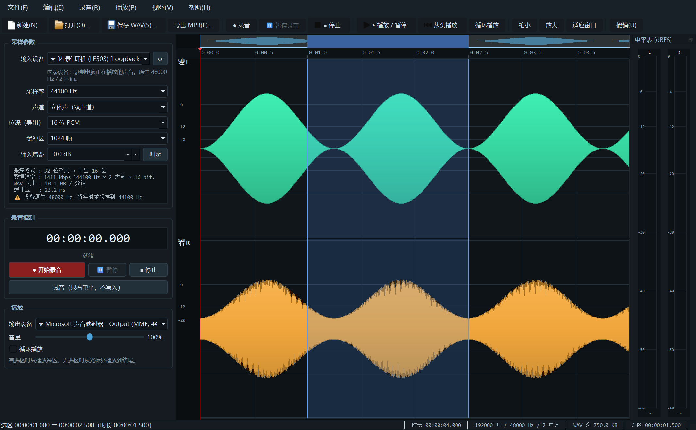
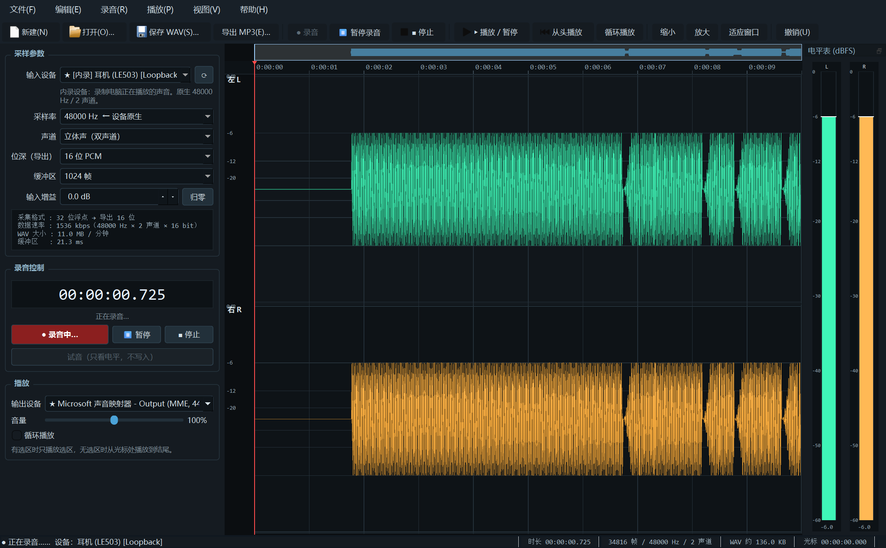
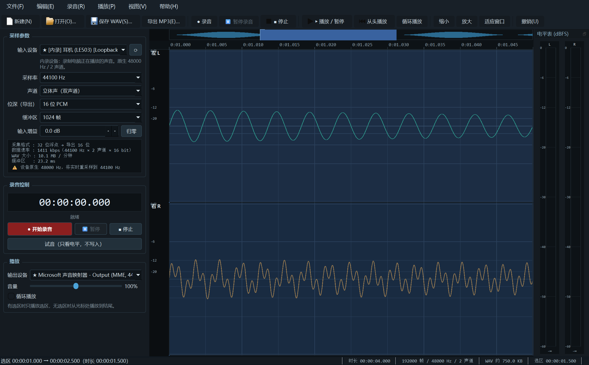
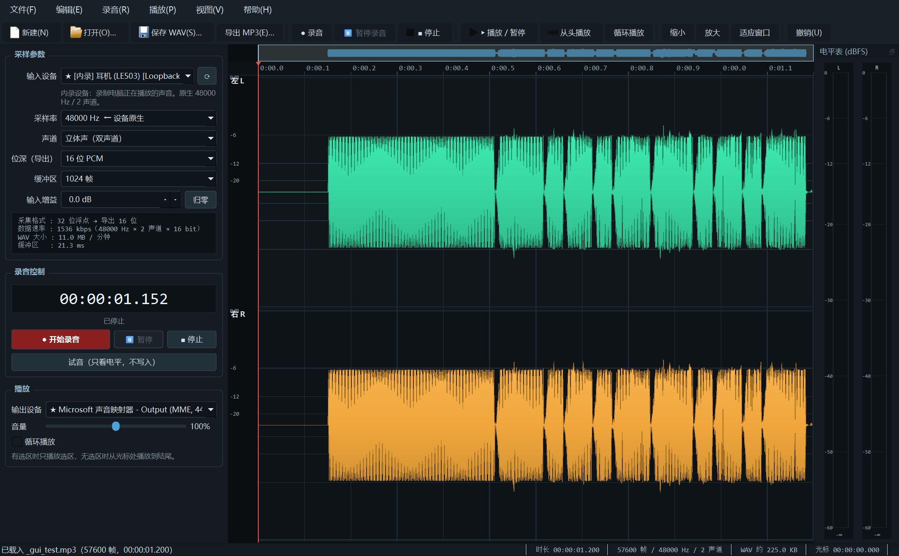
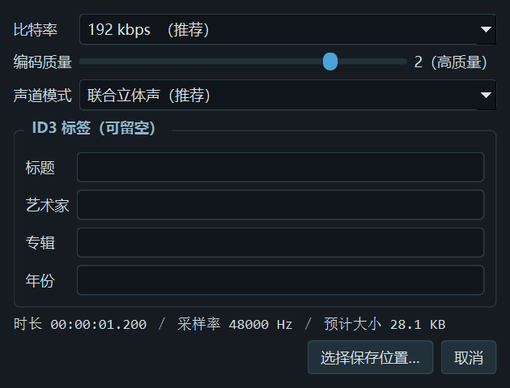
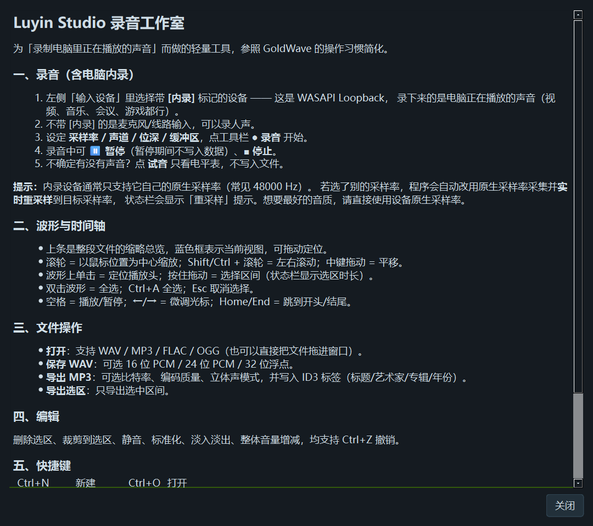

# Luyin Studio 录音工作室

<p align="center">
  <a href="LICENSE"></a>
  
  
  
  <a href="https://github.com/red-tassel-zhang/luyin-stdio/actions/workflows/build-windows.yml"></a>
  <a href="https://github.com/red-tassel-zhang/luyin-stdio/releases/latest"></a>
</p>

一个为 **“录制电脑里正在播放的声音”** 而写的 Windows 桌面录音 / 编辑 / 导出工具。
参照 GoldWave 的用法做了大幅简化：双声道、实时波形、电平表、参数可见、导出 MP3，全部在一个窗口里完成。

> 为什么不用 GoldWave？因为它太复杂了。这个工具打开就能录，录完就能存 MP3。



---

## 一、功能一览

| 分类 | 能力 |
| --- | --- |
| **录音** | WASAPI Loopback **电脑内录**（视频/音乐/会议/游戏声音）、麦克风/线路输入；开始 / 暂停 / 继续 / 停止；录音计时；试音模式（只看电平不写入） |
| **采样参数** | 输入设备、采样率（8 k–192 kHz）、声道（单声道 / **立体声**）、位深（16 / 24 / 32 位浮点）、缓冲区（128–8192 帧）、输入增益（±24 dB）；实时显示数据速率、每分钟文件大小、缓冲区延迟 |
| **音轨显示** | 立体声双轨波形、整段缩略总览条、自适应时间标尺、dB 刻度网格、播放头、选区高亮、缩放/平移、录音时自动跟随滚动 |
| **电平表** | 左右声道独立的 dBFS 电平表（RMS + 峰值保持 + 削波指示），无界面刷新卡顿 |
| **播放** | 播放 / 暂停 / 停止、从头播放、循环播放、播放选区、音量 0–200%、点击波形定位 |
| **文件操作** | 新建、打开（WAV / MP3 / FLAC / OGG，支持拖拽）、保存 WAV（16/24/32f）、导出 MP3（比特率 / 质量 / 立体声模式 / ID3 标签）、仅导出选区 |
| **编辑** | 全选、取消选择、删除选区、裁剪到选区、静音、标准化、淡入、淡出、音量调整、撤销（Ctrl+Z） |
| **打包** | 一键打包为**单文件 exe**（无需安装 Python） |

---

## 二、快速开始

### 方式 1：从源码运行（推荐）

需要 Python 3.10+（开发验证环境为 3.12.4）：

```bat
git clone https://github.com/red-tassel-zhang/luyin-stdio.git
cd luyin-stdio

python -m pip install -r requirements.txt
python fetch_deps.py        :: 下载 vendor\ 里的三个二进制依赖，只需执行一次
python main.py
```

`fetch_deps.py` 会从 PyPI 拉取与本机 Python 版本匹配的 wheel 并解包到 `vendor/`。
这些二进制**不随仓库分发**（原因见「十一、第三方与许可」），所以这一步不能省。

不开界面、只验证设备与编解码链路：

```bat
python main.py --selftest
```

### 方式 2：直接用打包好的 exe

到本仓库的 [Releases](../../releases) 页面下载 `LuyinStudio.exe`，双击即用，无需 Python 与任何依赖。
首次启动会把运行库解压到临时目录，约需 3–15 秒（视磁盘而定），之后启动更快。
最新版是 [v1.0.0](https://github.com/red-tassel-zhang/luyin-stdio/releases/tag/v1.0.0)（由 CI 在 windows-latest 上自动打包）。
若想自己打一个，见方式 3。

### 方式 3：自己打包成单文件 exe

```bat
python -m pip install -r requirements-dev.txt
python fetch_deps.py
python build.py
```

产物 `dist\LuyinStudio.exe`（单文件、约 60 MB，免安装）。打包相关命令：

| 命令 | 作用 |
| --- | --- |
| `python build.py` | 生成图标 + PyInstaller 打包 + 自动自检（约 1–2 分钟） |
| `python build.py --icon` | 只重新生成 `app.ico` |
| `python build.py --verify` | 只对已打包的 exe 跑自检 |
| `python build.py --debug` | 打一个带控制台的调试版并立即运行，便于看启动报错 |
| `python build.py --debug-dir` | 打一个免解压的目录版（onedir），排查环境问题最方便 |

打包时脚本会自动处理两个容易踩的坑：

1. 把 Qt 运行库所在目录（conda 环境下 Qt6Core/Gui/Widgets 等 DLL 常在 `Library\bin`，而它不在 PATH 上）加入搜索路径，
   否则打出来的 exe 会缺少 Qt 运行库、启动即报 `DLL load failed while importing Shiboken`；
2. 显式带上 `cffi / _cffi_backend`，否则 `miniaudio` 无法 import，打不开 MP3/FLAC。

打包完成后会自动运行 `LuyinStudio.exe --selftest` 做自检（导入、设备枚举、内录、MP3 往返、窗口构造），
看到 `RESULT=OK` 即为成功。推送 `v*` 标签会触发
[.github/workflows/build-windows.yml](.github/workflows/build-windows.yml) 自动打包并把 exe 附到 Release。

---

## 三、怎么录电脑里的声音（内录）

1. 打开程序，左侧 **输入设备** 里选择带 **`[内录]`** 标记的那一项，例如
   `★ [内录] 耳机 (LE503) [Loopback] (Windows WASAPI, 48000 Hz)`。
   它就是 Windows 的 WASAPI Loopback 设备，录到的正是电脑正在播放的声音。
2. 不带 `[内录]` 的是麦克风 / 线路输入。
3. 不确定有没有声音？先点 **试音（只看电平，不写入）**，看右侧电平表有没有跳动。
4. 点 **● 录音**（F9）开始，**⏸ 暂停**（F10）可暂停（暂停期间不写入数据），**■ 停止**（F11）结束。
5. 停止后点 **导出 MP3**（Ctrl+E）或 **保存 WAV**（Ctrl+S）。

> **关于采样率：** 内录设备通常只允许使用它自己的原生采样率（一般是 48000 Hz）。
> 如果你在采样率里选了别的值，程序会自动改用原生采样率采集，再**实时重采样**到你要的采样率，
> 并在参数面板给出黄色提示。想要最纯净的音质，就用标注 `← 设备原生` 的那一档。

---

## 四、采样参数说明

| 参数 | 说明 | 建议 |
| --- | --- | --- |
| 采样率 | 每秒采样点数。越高越保真、文件越大 | 内录用设备原生 48000 Hz；语音 16000–22050 Hz |
| 声道 | 单声道 / 立体声 | 录音乐、视频用**立体声** |
| 位深 | 导出 WAV 的量化位深（16 位 PCM / 24 位 PCM / 32 位浮点） | 普通用途 16 位；后期处理留 24/32 位 |
| 缓冲区 | 每次交给声卡的帧数，越小延迟越低但越容易爆音 | 1024 帧（≈21 ms）最稳；录音卡顿就调到 2048/4096 |
| 输入增益 | 采集时的数字增益 | 一般保持 0 dB，避免削波 |

面板会实时算出 **数据速率（kbps）**、**WAV 每分钟体积** 与 **缓冲区延迟（ms）**。

---

## 五、波形与快捷键

| 操作 | 效果 |
| --- | --- |
| 滚轮 | 以鼠标位置为中心缩放 |
| Shift / Ctrl + 滚轮 | 左右滚动 |
| 中键拖动 | 平移视图 |
| 波形上单击 / 拖动 | 定位播放头 / 选择区间 |
| 双击波形 | 全选 |
| 顶部总览条点击拖动 | 快速跳转 |
| 空格 | 播放 / 暂停 |
| ← → | 微调光标 |
| Ctrl+N / Ctrl+O / Ctrl+S / Ctrl+E | 新建 / 打开 / 保存 WAV / 导出 MP3 |
| F9 / F10 / F11 | 录音 / 暂停 / 停止 |
| Ctrl+A / Esc / Del / Ctrl+T / Ctrl+Z | 全选 / 取消选择 / 删除选区 / 裁剪 / 撤销 |
| F1 | 使用说明 |

---

## 六、界面预览

| 界面 | 说明 |
| --- | --- |
|  | 立体声波形 + 选区 + 总览条 + 参数面板 |
|  | 录音中：实时波形跟随、计时、电平表 |
|  | 放大到毫秒级看波形细节 |
|  | 打开 MP3 后可直接编辑 |
|  | 导出 MP3：比特率 / 质量 / 立体声模式 / ID3 标签 |
|  | 内置使用说明与快捷键（F1） |

---

## 七、目录结构

```
luyin-stdio/
├── main.py                      程序入口（含 --selftest 自检模式）
├── luyin/
│   ├── engine.py                音频引擎：设备枚举、采集、播放、重采样、编解码
│   ├── widgets.py               波形视图、缩略总览、时间标尺、电平表
│   ├── dialogs.py               导出 MP3 对话框、使用说明窗口
│   └── mainwindow.py            主窗口、菜单、工具栏、参数面板、文件与编辑操作
├── fetch_deps.py                下载 vendor/ 中的三个二进制依赖（首次运行前执行一次）
├── build.py                     打包脚本（生成 ico + PyInstaller + 自检）
├── requirements.txt             运行依赖
├── requirements-dev.txt         打包依赖
├── .github/workflows/           CI：推送 v* 标签自动打包并发布 Release
├── screenshots/                 界面截图
├── LICENSE                      MIT 许可证
├── vendor/                      ← 不入库，由 fetch_deps.py 下载生成
│   ├── pyaudiowpatch/           PortAudio（含 WASAPI Loopback 支持）→ 采集/播放
│   ├── lameenc*.pyd             LAME 编码器 → 导出 MP3
│   └── miniaudio*.pyd           miniaudio → 打开 MP3/FLAC/OGG/WAV
├── app.ico                      ← 生成物，由 build.py 生成
└── dist/LuyinStudio.exe         ← 生成物，打包产物
```

---

## 八、技术实现

| 环节 | 方案 | 说明 |
| --- | --- | --- |
| 采集 / 播放 | **PyAudioWPatch**（PortAudio + WASAPI Loopback 补丁） | 唯一能直接内录系统声音的稳定方案；采样格式统一为 32 位浮点 |
| 采样率回退 | 自研 `LinearResampler` | 设备不支持目标采样率时，按原生采样率采集并流式重采样，块间相位连续 |
| MP3 编码 | **lameenc**（LAME） | 支持比特率 / 质量 / 联合立体声 / 单声道，分块编码以便显示进度 |
| ID3 标签 | 自写 ID3v2.3（UTF-16） | 中文标题/艺术家不乱码 |
| 解码打开 | **miniaudio** | MP3 / WAV / FLAC / OGG 一次搞定，按文件原始采样率解码不重采样 |
| WAV 写出 | 自写 RIFF 写入器 | 16 位 PCM / 24 位 PCM / 32 位浮点均正确标注格式 |
| 波形渲染 | numpy `reduceat` 峰值抽取 + 增量峰值缓存（256 帧/块） | 缩略图 O(列数)，长时间录音也能 30 fps 流畅重绘 |
| 界面 | **PySide6**（Qt 6） | 双缓冲绘制、Dock 电平表、原生文件对话框 |
| 打包 | **PyInstaller**（onefile + windowed） | 单文件 exe 59.5 MB，含 Qt 插件与全部音频库 |

---

## 九、本机验证记录

| 项目 | 结果 |
| --- | --- |
| 源码模式 · 内录 | 播放 440 Hz 测试音同时内录，峰值 0.3500 与播放幅度完全一致 ✓ |
| 源码模式 · 双声道 | 左右声道独立波形、独立电平表 ✓ |
| 采样率回退 | 请求 44100 Hz、设备原生 48000 Hz → 自动重采样，录音时长正确 ✓ |
| WAV 往返 | 16 / 24 / 32 位浮点写出后再读回，帧数与峰值一致 ✓ |
| MP3 往返 | 192 kbps 编码 → 解码回读，峰值误差 < 1%，ID3 中文标签正常 ✓ |
| 麦克风输入 | 可用（能打开并采到数据）✓ |
| 打包 | `dist\LuyinStudio.exe` 59.5 MB，`--selftest` 返回 `RESULT=OK` ✓ |
| exe 实机启动 | 双击后窗口正常显示、设备列表正常（10 输入 / 8 输出）✓ |

---

## 十、第三方与许可

本程序以 **MIT 许可证** 发布，见 [LICENSE](LICENSE)。它依赖以下第三方组件，版权归各自作者所有：

| 组件 | 用途 | 许可证 | 是否随本仓库分发 |
| --- | --- | --- | --- |
| [PySide6 / Qt for Python](https://pypi.org/project/PySide6/) | 图形界面 | LGPL-3.0 | 否，pip 安装 |
| [NumPy](https://pypi.org/project/numpy/) | 波形数据处理 | BSD-3-Clause | 否，pip 安装 |
| [cffi](https://pypi.org/project/cffi/) | miniaudio 的 FFI 依赖 | MIT | 否，pip 安装 |
| [PyAudioWPatch](https://pypi.org/project/PyAudioWPatch/) | WASAPI Loopback 内录（PortAudio） | MIT | 否，`fetch_deps.py` 下载 |
| [lameenc](https://pypi.org/project/lameenc/) | MP3 编码（LAME） | LGPL-2.1 | 否，`fetch_deps.py` 下载 |
| [miniaudio](https://pypi.org/project/miniaudio/) | 音频解码 | MIT-0 | 否，`fetch_deps.py` 下载 |

**为什么 `vendor/` 不进仓库**：其中 LAME（经由 lameenc）是 LGPL 授权的，把它连同本程序
一起放进 Git 仓库会带来不必要的再分发问题。仓库只保留 `fetch_deps.py`，由使用者在本机按需
下载——仓库干净，每个人也清楚自己在用什么。

如果你要再分发打包好的 exe，请一并遵守上述组件的许可证（LGPL 部分需保留其声明）。

---

## 十一、已知限制

* 内录时如果系统完全静音，WASAPI 可能不推送数据包，录音时长会短于实际计时——这是 Loopback 的固有行为。
* 设备不支持目标采样率时会走线性插值重采样；大幅度降采样（如 48 kHz → 16 kHz）建议改用设备原生采样率或外部工具。
* 32 位浮点 WAV 用 `fmt tag = 3` 写出，绝大多数播放器与 DAW 都支持。
* 仅支持 Windows（WASAPI Loopback 是 Windows 专有）。
* 单文件 exe 首次启动需要解压运行库到 `%TEMP%`；若杀毒软件拦截未知程序写临时目录，请把它加入白名单，
  或改用 `python build.py --debug-dir` 打一个免解压的目录版。
